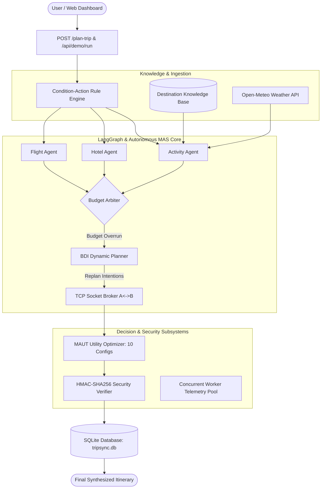

# SmartTrip AI — Autonomous Multi-Agent Travel Planning & Negotiation System

[](tests/)
[](api/main.py)
[](graph/)
[](frontend/)
[](frontend/)
[](LICENSE)

**SmartTrip AI** is an enterprise-grade autonomous multi-agent platform designed for intelligent travel planning, real-time budget negotiation, multi-attribute decision theory optimization, and cryptographic verification.

Built on **LangGraph, FastAPI, and React**, the system transforms traditional linear travel planning into an autonomous society of specialized agents that deliberate, bid, exchange framed TCP socket messages, dynamically replan around environmental shocks (BDI), and enforce HMAC-SHA256 zero-trust security.

---

## 1. Complete Assignment Implementation Mapping

All 10 required academic and architectural assignments are fully implemented, tested, and integrated into the live interactive dashboard:

| # | Assignment Module | Core Implementation | Key Endpoints | Documentation & Tests |
| :-: | :--- | :--- | :--- | :--- |
| **1** | **PEAS & Environment** | 8 Agent Personas, PEAS Matrices, Russell & Norvig Taxonomy, Agent vs. OOP comparison | `GET /api/peas` | [`docs/PEAS_AND_ENVIRONMENT.md`](docs/PEAS_AND_ENVIRONMENT.md)<br>`tests/test_smarttrip_modules.py::test_assignment_1_*` |
| **2** | **Rule Engine** | Forward-chaining Condition-Action rule heuristics for traveler personas, budget shifts, and destination suitability | `POST /api/rules/evaluate` | [`smarttrip/rule_engine.py`](smarttrip/rule_engine.py)<br>`tests/test_smarttrip_modules.py::test_assignment_2_*` |
| **3** | **Concurrency & Latency** | Multi-threaded background telemetry workers (`threading.Thread`, `queue.Queue`, mutex locks) with microsecond latency logging | `GET /api/concurrency/status`<br>`POST /api/concurrency/trigger` | [`smarttrip/concurrency.py`](smarttrip/concurrency.py)<br>`tests/test_smarttrip_modules.py::test_assignment_3_*` |
| **4** | **TCP Socket Communication** | Low-level TCP client-server exchange (Agent A $\leftrightarrow$ Agent B) with serialized newline-framed JSON protocols and latency metrics | `POST /api/socket/run-exchange` | [`smarttrip/socket_comm.py`](smarttrip/socket_comm.py)<br>`tests/test_smarttrip_modules.py::test_assignment_4_*` |
| **5** | **Multi-Agent Negotiation** | Multi-turn proposal & bidding protocol (Flight, Hotel, Activity, Budget Arbiter) with concessions and consensus | `POST /api/negotiation/run` | [`smarttrip/negotiation.py`](smarttrip/negotiation.py)<br>`tests/test_smarttrip_modules.py::test_assignment_5_*` |
| **6** | **Utility Optimization** | Multi-Attribute Utility Theory (MAUT): $U(c) = \sum w_i U_i(c)$ evaluating and ranking 10 diverse configurations | `POST /api/utility/optimize` | [`smarttrip/utility_optimizer.py`](smarttrip/utility_optimizer.py)<br>`tests/test_smarttrip_modules.py::test_assignment_6_*` |
| **7** | **BDI Architecture** | Formal Beliefs, Desires, Intentions architecture with dynamic replanning upon price surges (+65%) and storm events | `POST /api/bdi/replan` | [`smarttrip/bdi_agent.py`](smarttrip/bdi_agent.py)<br>`tests/test_smarttrip_modules.py::test_assignment_7_*` |
| **8** | **Knowledge & Weather API** | Structured JSON destination ontology + live Open-Meteo REST API forecast integration with high-fidelity fallback | `GET /api/knowledge/destination/{city}`<br>`GET /api/weather/{city}` | [`smarttrip/knowledge_weather.py`](smarttrip/knowledge_weather.py)<br>`tests/test_smarttrip_modules.py::test_assignment_8_*` |
| **9** | **Cryptographic Security** | Zero-trust HMAC-SHA256 signature generation, tamper detection, sender whitelisting, and replay prevention | `GET /api/security/audit`<br>`POST /api/security/verify` | [`smarttrip/security.py`](smarttrip/security.py)<br>`tests/test_smarttrip_modules.py::test_assignment_9_*` |
| **10** | **Capstone Integration** | Unified end-to-end execution pipeline uniting all 9 subsystems, live SSE streaming, and SQLite persistence | `POST /api/demo/run`<br>`GET /api/demo/history`<br>`POST /plan-trip` | [`smarttrip/capstone.py`](smarttrip/capstone.py)<br>`tests/test_smarttrip_modules.py::test_assignment_10_*` |

---

## 2. System Architecture



---

## 3. Quickstart & Local Setup

### Prerequisites
- Python 3.10+
- Node.js 18+ and npm

### 1. Backend Setup
```bash
# Create and activate virtual environment
python3 -m venv .venv
source .venv/bin/activate

# Install dependencies
pip install -r requirements.txt

# Run full test suite (149 tests)
pytest tests/

# Launch FastAPI development server
uvicorn api.main:app --reload --port 8000
```

Backend endpoints will be available at `http://localhost:8000`:
- Interactive Swagger API docs: `http://localhost:8000/docs`
- Health check: `http://localhost:8000/health`
- Capstone Demo Execution: `http://localhost:8000/api/demo/run`

### 2. Frontend Setup
```bash
# Navigate to frontend directory
cd frontend

# Install dependencies
npm install

# Build for production
npm run build

# Start Vite development server
npm run dev
```

Frontend dashboard will be accessible at `http://localhost:5173`.

---

## 4. REST API Endpoint Reference

| Method | Route | Description |
| :--- | :--- | :--- |
| `GET` | `/health` | System health check (`status: ok`) |
| `GET` | `/api/status` | Comprehensive status across all 8 registered agents |
| `GET` | `/api/peas` | Full PEAS matrix, environment taxonomy & OOP comparison |
| `POST` | `/api/rules/evaluate` | Evaluates forward-chaining travel condition-action rules |
| `GET` | `/api/concurrency/status` | Live thread count, queue depth, and microsecond latency stats |
| `POST` | `/api/concurrency/trigger` | Dispatches background telemetry load batch |
| `POST` | `/api/socket/run-exchange` | Executes low-level TCP socket handshake & quote exchange |
| `POST` | `/api/negotiation/run` | Multi-turn proposal, bidding, and consensus protocol |
| `POST` | `/api/utility/optimize` | Evaluates and ranks 10 travel options using MAUT |
| `POST` | `/api/bdi/replan` | Demonstrates belief revision & intention recovery after shock |
| `GET` | `/api/knowledge/destination/{city}` | Retrieves destination profile from JSON ontology |
| `GET` | `/api/weather/{city}` | Live weather forecast with mock fallback |
| `GET` | `/api/security/audit` | Audits 5 cryptographic test cases (tamper/replay/rogue) |
| `POST` | `/api/security/verify` | Verifies inbound HMAC-SHA256 signed message |
| `POST` | `/api/demo/run` | Executes complete end-to-end 10-stage lifecycle |
| `GET` | `/api/demo/history` | Fetches saved SQLite itinerary history |
| `POST` | `/plan-trip` | Streams LangGraph SSE node progress live |

---

## 5. Deployment Guide (Vercel)

The application is architected for seamless Vercel deployment:
- **Frontend**: Vite static build deployed to edge CDN (`frontend/dist`).
- **Backend API**: Python serverless runtime via `@vercel/python` and `api/index.py`.
- **Database**: SQLite storage configured with automatic fallback to `/tmp/tripsync.db` under serverless read-only restrictions.

Deploy command:
```bash
vercel --prod
```

---

## 6. Verification & Test Results

```text
============================= test session starts ==============================
platform darwin -- Python 3.13.1, pytest-9.1.1, pluggy-1.7.0
rootdir: /Users/hassan/AGENT_TECHNOLOGY/multi-agent-ai-travel-planner
plugins: langsmith-0.15.0, anyio-4.16.0, respx-0.23.1
collected 149 items

tests/test_amadeus_client.py .........                                   [  6%]
tests/test_api.py .........                                              [ 12%]
tests/test_cache.py ................                                     [ 22%]
tests/test_client_caching.py ...                                         [ 24%]
tests/test_config.py ....                                                [ 27%]
tests/test_data_service.py .........................                     [ 44%]
tests/test_domain_agents.py ..........                                   [ 51%]
tests/test_google_places_client.py .....                                 [ 54%]
tests/test_graph_integration.py ......                                   [ 58%]
tests/test_live_api_fallback.py .....................                    [ 72%]
tests/test_pricing_agent.py .............                                [ 81%]
tests/test_smarttrip_modules.py ........................                 [ 97%]
tests/test_storage.py ....                                               [100%]

============================= 149 passed in 5.66s ==============================
```

---

## 7. Faculty & Project Collaborators

- **GitHub Owner**: `mhassanworks`
- **Target Repository**: `smarttrip-ai-agent`
- **Faculty Collaborator**: `rameshbabu.pv@gmail.com`
- **Project Lead**: Hasan

For in-depth execution logs, see [`docs/SAMPLE_EXECUTION_LOGS.md`](docs/SAMPLE_EXECUTION_LOGS.md).
